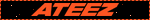
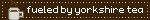
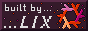
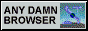

 

 

 

 

devsecops engineer: kubernetes on aws (eks, karpenter, helm), opentofu, ansible, vault, sops.
work stuff is private, side projects below. [dappy.lgbt](https://dappy.lgbt)

- [pixeldish](https://github.com/dappermint/pixeldish) (swift): dithered procedural wallpapers for macos, in your menu bar
- [winecx-gptk](https://github.com/dappermint/winecx-gptk) (c): crossover's wine patches rebased onto upstream wine 11.15 so gptk/d3dmetal runs on it
- [glass](https://github.com/dappermint/glass) (go): attach a live console to a running go service over a unix socket
- [omniwm](https://github.com/OmniNull/OmniWM) (swift): tiling window manager for apple silicon macs, niri-style scrolling and dwindle bsp. contributor
- [whisky](https://github.com/frankea/Whisky) (swift): community fork of the archived whisky wine wrapper for macos. contributor

go · swift · c · nix · python &nbsp;·&nbsp; macos on nix-darwin, fish &nbsp;·&nbsp; `brew tap dappermint/tap`

 

  

